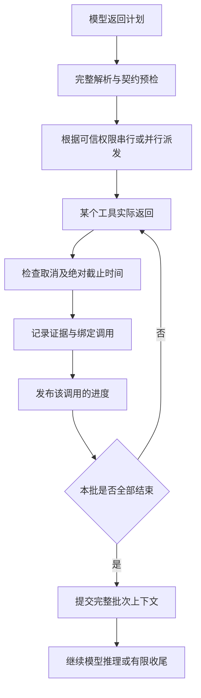

# 通用 Agent 执行边界

目标是支持不同工具、模型和算力设备，而不是识别某一道题并拼接答案。业务示例用于回归和效果评估，不能成为调度器或提示词里的分支条件。

## 职责

| 层 | 负责 | 边界 |
| --- | --- | --- |
| 模型 | 理解请求、选择工具、解释和综合 | 模型给出的 Observation 或成功声明不是执行证据 |
| 协议与契约 | 解析完整响应，检查输入、目标关联和声明的结果字段 | 不根据业务关键词替模型编造工具结果 |
| 工具注册与调度 | 可信权限、并行许可、调用标识、缓存、超时和取消 | 模型不能自行授予并行或写入权限 |
| 执行记录 | 按调用标识保存实际输入、状态和返回证据 | 返回顺序不能改变证据归属；展示文案不能冒充结构化事实 |
| 综合与收尾 | 使用本次证据，执行既有校验，必要时有限修复 | 不能无限重试、把旧对话当新证据，或让迟到结果覆盖终态 |

工具领域知识放在各自的工具及契约内；通用执行链不包含天气、车票、地点等场景分支。新工具应通过注册和契约接入，而不是修改 Agent 主循环。

## 工具完成与模型轮次分开

“一个工具完成”与“整批完成”是两个不同的时刻：

- 每个工具完成时，先记录证据，再通知观察者。观察者读取到的状态与进度事件一致。
- 并行工具按实际完成时间显示进度，保留原调用标识和实际参数。整批结束后才开始下一轮模型推理，防止遗漏尚在运行的独立查询或提前执行依赖步骤。
- 串行调用之间重新检查停止状态。用户或调用方在上一项进度事件中停止任务时，下一项操作还没有开始。
- 取消和总超时只保留截止前已经记录的结果。忽略取消的工具仍可能在外部执行，但其迟到返回不能添加新证据或进度。
- 观察者或执行内部抛错时，先关闭事件入口并取消剩余调用，再向调用方返回异常。

这次调整只改变结果记录与通知的时机，不新增模型调用、不强制所有任务先规划，也不改变缓存和并行权限规则。

## 提示与校验

提示描述协议、证据边界和当前阶段，避免不断追加业务示例。实际执行参数、结果和校验原因随数据传递，不写成面向特例的系统规则。

可验证的格式和结构化字段由程序检查，理解、推断和建议由模型完成。自然语言启发式只能作为辅助，不能当作全面语义验证；既有兼容工具仍有此限制。后续应优先完善工具契约和结构化返回，而不是继续增加跨业务的正则纠错。

性能评估同时记录模型轮次、输入大小、各阶段耗时、工具完成与进度发布的间隔。进度提前显示不等于 NPU 推理加速；会话/KV 复用需要独立验证，不能仅凭提示精简就宣称生效。

## 回归原则

通用回归使用可改名的工具、结构化返回、独立与依赖任务，以及可控的延迟、失败和取消。验证证据归属、已完成结果保留、批次屏障、有限修复和终态隔离。原来的复合查询继续作为业务回归样本；受控测试通过不代表实际模型必然正确回答。

2026-10-19 本次调整通过 Agent-core 14/14 组回归，其中实际注册器与执行器测试 82/82；聊天端 SDK `default@CompileArkTS` 成功，`git diff --check` 通过。新增检查覆盖并行乱序返回、慢工具忽略取消、串行中途停止、进度回调抛错和定时器延迟。未打包签名或安装新的 HAP；进度及中断行为的真机体验仍需更新聊天端后验证。

## 异构算力与多个聊天来源

同一算力集群按请求需要的能力筛选节点，再结合可用状态、负载和模型档位选路由。文本设备和视觉设备可以同时处理来自不同聊天设备的请求；一种能力的忙碌不应挡住另一种能力的空闲设备。来源会话与请求编号共同标识请求，回复按独立的转发编号返回来源。

若要让视觉设备专门接图片，应在该设备选择 VL（仅带图片），使其仅上报视觉能力；“自动”模式还可能上报文本能力并承接文本请求。两台聊天设备需接入同一个算力设备 1，其他算力设备加入该集群。单个聊天界面仍一次发送一个完整任务；Agent 拆分可能使用多个文字设备，并不承诺一台聊天设备独占一台算力。

混合路由回归 41/41 通过，新增检查覆盖两个聊天来源、两个文字节点和一个视觉节点的交错请求、相同客户端请求编号的隔离、完成后的资源释放，以及文本节点都忙时向空闲视觉节点派发图片。这些是受控路由测试，未替代五台真实设备的连接及模型执行联测。

## 算力端推理详情

保留现有“输出 / 输入 / 运行信息”页签，使用一份单栏轮次列表切换内容。列表摘要显示轮次、执行设备、请求耗时和状态，不同时铺开多台设备的输入输出。轮次列表限制高度并独立滚动，选中的轮次定位到可见区域；新轮次或流式更新不替用户切换正在查看的记录。

普通多轮 Agent 和拆分任务都可查看各次实际调用。主算力设备已观察到的转发请求通过独立的 `remoteCalls` 详情数据提供，主任务列表与“本机推理中”仍只使用本机执行记录。跨设备查看按父任务与子任务标识限定范围，不混入其他聊天来源的任务。工作设备没有接收到远端逐轮记录时，仅展示已有返回结果，不构造虚假的输入、调用次数或耗时。

“本轮请求”指该记录观察位置的请求耗时，含排队、加载、推理与传输；它不是纯 NPU 时间，各轮并行时也不能相加作为总任务耗时。“返回结果”的任务说明和各轮的实际模型输入分别展示，避免将汇总摘要当作模型原始返回。

此次改动位于算力端仪表盘及详情数据，不改变模型调用和推理协议。详情场景、原有任务分组及滚动检查通过，算力端 ArkTS 编译成功。已使用独立无头浏览器检查 1280×900 和 390×844 布局，无横向溢出，选中轮次可见，保留可滚动的输出区域；尚未打包安装或进行真机触屏验证。
